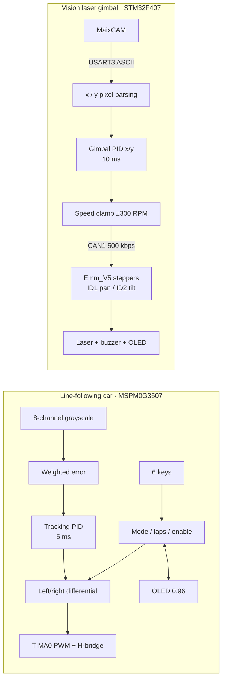

# 2025 Electronic Competition — Line-Following Car & Vision Laser Gimbal

> An open-source starter template built from a 2025 National Undergraduate Electronics Design Contest entry.
> Two independent bare-metal MCU projects, fully commented, ready to compile:
> a grayscale line-following car on **TI MSPM0G3507**, and a **vision-tracking laser gimbal** on **STM32F407VET6**.

<p>


</p>

> 中文主文档见 [README.md](README.md)，内容更完整（含引脚表、调参指南、已知问题）。

## What's inside

| Project | MCU | Core loop | Highlights |
|---|---|---|---|
| `MSPM0G3507_Project` | MSPM0G3507 (Cortex-M0+, 80 MHz) | 8-channel grayscale + weight-based error + position PID, 5 ms timer tick | 3 running modes (turns, fine-tuned turning, U-turn), lap counting, OLED debug UI |
| `STM32F407VET6_Project` | STM32F407VET6 (Cortex-M4F, 168 MHz) | MaixCAM pixel coordinates over USART3 → PID (10 ms) → CAN velocity commands to Emm_V5 closed-loop steppers | 3 mission strategies (KM2/KM3/KM4), auto-scan on target loss, laser + buzzer hit indication |

## System architecture



## Quick start

```text
1) Install: Keil MDK v5 + MSPM0G3507 / STM32F4xx device packs
            + TI MSPM0 SDK 2.01.00.03 (expected at D:\ti by default)
2) Open:    MSPM0G3507_Project/keil/empty_LP_MSPM0G3507_nortos_keil.uvprojx
            STM32F407VET6_Project/MDK-ARM/Diansai.uvprojx
3) Build → flash → power up. Key mappings are listed in the Chinese README.
```

| Project | Toolchain | Config tool | Firmware library |
|---|---|---|---|
| MSPM0 car | ARMCLANG V6.22 | TI SysConfig (`empty.syscfg`) | MSPM0 DriverLib |
| STM32 gimbal | ARMCC V5.06 (AC5) | STM32CubeMX (`Diansai.ioc`) | STM32 HAL |

> ⚠️ The MSPM0 project hard-codes the SDK path `D:\ti\mspm0_sdk_2_01_00_03` (include paths + a pre-build `syscfg.bat` call). Change both entries if your SDK lives elsewhere.

## Build notes and known issues

- MSPM0: never hand-edit `ti_msp_dl_config.c/h` — edit `empty.syscfg` and let SysConfig regenerate them.
- STM32: keep handwritten code inside `USER CODE` blocks; regenerating from `.ioc` may overwrite the Keil file groups.
- STM32 quirks worth knowing before you debug (all marked in source comments):
  - USART3 IDLE handler restarts DMA with length **16** while the buffer/start length is **256** → long frames get truncated.
  - `MaixCAM_data_manage()` returns early on parse failure, skipping buffer clear + DMA restart → vision stream stalls until reset.
  - USART6 (HWT101 gyro) reception is never started, so `Yaw` stays 0 and head-lock logic is inert.
  - `cloud_platformSpeed()` blocks with `while(can.rxFrameFlag == false)` after each transmit.
  - `BUZZER.h` is uppercase while the file is `Buzzer.h` — breaks case-sensitive builds.
- MSPM0 quirks: TIMG0 tick is actually **5 ms** (old comments said 10 ms); servo PWM period ≈ 2 ms does not match a 0.5–2.5 ms servo (servo path unused).
- Source files are mixed GBK / UTF-8 (historical). Keep the original encoding and line endings when editing; never insert a `*/` sequence inside a block comment.

## Tuning cheatsheet

| Project | Parameter | File | Current |
|---|---|---|---|
| Car | `automatic_KP/KI/KD` | `Hardware/grayscale_sensor.h` | 13 / 0.0 / 0.003 |
| Car | sensor weights | `Hardware/grayscale_sensor.c` | −3 … +3 |
| Gimbal | KM2/KM3 incremental PID | `Hardware/Dloud_deck.h` | 0.08 / 0.12 with small I, D |
| Gimbal | KM4 position PID (`T_` prefix) | `Hardware/Dloud_deck.h` | 0.11 / 0.10 |
| Gimbal | target pixels | `Dloud_deck.c` `Cloud_platform_PID_Scan()` | x=170, y=115~118 |

## Contributing

Fork → branch → PR. Commit style: `feat(scope)`, `fix(scope)`, `docs(scope)`, `refactor(scope)`, `chore`.
Please keep source encoding/EOL intact, do not commit build outputs, and update the pin tables when hardware changes.

## License

GPL-3.0 — see [LICENSE](LICENSE).
`Ground/Emm_V5.c/h` is third-party code by ZHANGDATOU (张大头闭环伺服); HAL/CMSIS and TI SDK files follow their own licenses.
