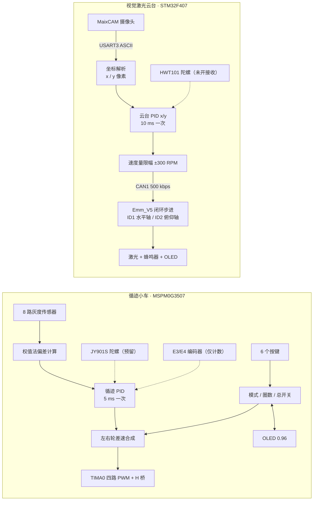
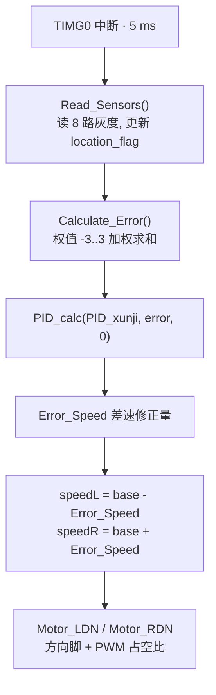
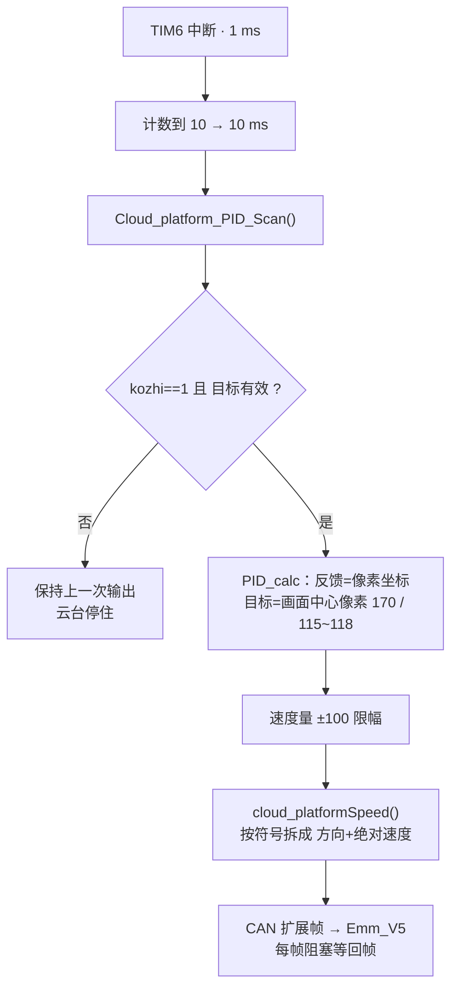

# 2025 电赛双工程：灰度循迹小车 & 视觉追踪激光云台

> 一套可直接编译、可直接上手的电赛小车类题目**开源模板**：两套独立工程，一套跑 TI MSPM0G3507 做灰度循迹，一套跑 STM32F407VET6 做视觉坐标闭环的激光云台。
> 代码全部带中文注释，按「文件头 → 函数 → 关键逻辑」三层组织，方便二次开发时按需删改。

<p>


</p>

---

## 目录

- [1. 项目简介](#1-项目简介)
- [2. 两个工程一览](#2-两个工程一览)
- [3. 快速开始](#3-快速开始)
- [4. 系统架构](#4-系统架构)
- [5. 硬件平台与引脚分配](#5-硬件平台与引脚分配)
- [6. 目录结构](#6-目录结构)
- [7. 模块说明](#7-模块说明)
- [8. 控制流程与时序](#8-控制流程与时序)
- [9. 通信协议](#9-通信协议)
- [10. 构建与烧录](#10-构建与烧录)
- [11. 调参与标定指南](#11-调参与标定指南)
- [12. 代码与注释约定](#12-代码与注释约定)
- [13. 已知问题与改进建议](#13-已知问题与改进建议)
- [14. 二次开发建议](#14-二次开发建议)
- [15. 贡献指南](#15-贡献指南)
- [16. 许可证与致谢](#16-许可证与致谢)
- [17. 版本记录](#17-版本记录)

---

## 1. 项目简介

本仓库是 2025 年全国大学生电子设计竞赛的参赛作品源码，赛后整理为**可复用的开源模板**。两个工程相互独立、不共享代码，可按需单独取用：

| 工程 | 解决的问题 | 技术路线 |
|---|---|---|
| `MSPM0G3507_Project` | 小车沿黑线自主循迹、按圈数停车、遇横向黑线自动掉头 | 8 路灰度传感器 + 权值法偏差 + 位置式 PID + 四路电机 PWM |
| `STM32F407VET6_Project` | 摄像头识别目标，二轴云台把激光打到目标上 | MaixCAM 串口坐标 + 增量式/位置式 PID + CAN 总线控制 Emm_V5 闭环步进 |

两个工程都是**裸机前后台架构**（无 RTOS）：时间敏感的控制运算放在定时器中断里，人机交互与通信解析放在主循环里。这样既保证了控制节拍稳定，也避免了初学者上手 RTOS 的门槛。

**适合谁用**

- 第一次做电赛小车/云台题，想要一套「能跑通、能看懂、能改」的起点代码；
- 想学习「传感器 → 误差 → PID → 执行器」这条最小闭环链路；
- 想参考 Keil + SysConfig / CubeMX 双工具链的工程组织方式。

---

## 2. 两个工程一览

| 项目 | 循迹小车 | 视觉激光云台 |
|---|---|---|
| MCU | MSPM0G3507（Cortex-M0+） | STM32F407VET6（Cortex-M4F） |
| 主频 | 80 MHz（HFXT 40 MHz → SYSPLL ×2） | 168 MHz（HSE 8 MHz → PLL） |
| 工具链 | Keil MDK + ARMCLANG V6.22 | Keil MDK + ARMCC V5.06（AC5） |
| 配置工具 | TI SysConfig（`empty.syscfg`） | STM32CubeMX（`Diansai.ioc`） |
| 底层库 | TI MSPM0 DriverLib | STM32 HAL |
| 感知 | 8 路灰度、JY901S 陀螺（预留）、E3/E4 编码器（仅计数） | MaixCAM 视觉（USART3）、HWT101 陀螺（预留） |
| 执行 | 4 路直流减速电机（PWM + H 桥） | 2 轴 Emm_V5 闭环步进（CAN）+ 激光 + 蜂鸣器 |
| 人机 | OLED 0.96"、6 按键、蜂鸣器 | OLED 0.96"、3 按键、LED ×4、蜂鸣器 |
| 控制节拍 | 5 ms 定时中断（约 200 Hz） | 1 ms 定时中断，10 ms 跑一次 PID（100 Hz） |
| 代码规模 | 24 个源文件 | 约 30 个业务源文件（HAL/CMSIS 除外） |

---

## 3. 快速开始

```text
1) 装工具：Keil MDK v5 + 对应器件包（MSPM0G3507 / STM32F4xx）
           + TI MSPM0 SDK 2.01.00.03（默认装在 D:\ti）
           + STM32CubeMX（仅改外设时才需要）

2) 开工程：
   MSPM0G3507_Project/keil/empty_LP_MSPM0G3507_nortos_keil.uvprojx
   STM32F407VET6_Project/MDK-ARM/Diansai.uvprojx

3) 编译 → 下载 → 上电，然后按下面「操作说明」让它动起来。
```

**上电操作说明（循迹小车）**

| 引脚 | 代码接口 | 作用 |
|---|---|---|
| PA30 | `Key_GetNum()` | 目标圈数 +4（OLED 上按 `quanshu/4` 显示圈数，上限 24） |
| PA31 | `Key_GetNum1()` | 总开关，翻转 `Key_flag1`；置 1 才开始跑车 |
| PB10 | `Key_GetNum10()` | 切换运行模式 0 → 1 → 2（OLED 第 1 行第 13 列显示模式号） |
| PB18 / PB19 | `Key_GetNum18()` / `Key_GetNum19()` | 模式 1 下基础速度 −10 / +10 |
| PB17 | `Key_GetNum17()` | 预留（当前未使用） |

**上电操作说明（视觉云台）**

| 按键 | 作用 |
|---|---|
| 按键 1（PD1） | 开启控制：云台先回零，再进入追踪 |
| 按键 2（PD0） | 关闭控制（KM3 中改为「反向扫图」） |
| 按键 3（PD12） | 切换科目策略 KM2 → KM3 → KM4（OLED 第 1 行第 8 列显示） |

---

## 4. 系统架构

### 4.1 两工程总览



### 4.2 循迹小车数据流



### 4.3 云台控制链



---

## 5. 硬件平台与引脚分配

### 5.1 MSPM0G3507（循迹小车）

| 功能 | 引脚 | 片上资源 | 说明 |
|---|---|---|---|
| 电机 PWM CH0~CH3 | PB8 / PB9 / PB12 / PB13 | TIMA0 CCP0~CCP3 | 5 MHz 计数、周期 1000 → **5 kHz**；循迹实际只用 CH3（左）、CH2（右） |
| 电机方向 | PB11·PB14（右上）<br/>PB20·PB21（左上）<br/>PB22·PB23（左下）<br/>PB24·PB25（右下） | GPIO 推挽 | 两脚互补电平控制 H 桥正反转 |
| 8 路灰度 | PB0、PB27、PB26、PA26、PA25、PA24、PA12、PA7 | GPIO 输入 | **低电平 = 压黑线**，权重 −3…+3 |
| 编码器 E3 / E4 | PB4·PB5 / PB6·PB7 | GPIOB 中断 | 4 倍频软解码计数，本版未参与闭环 |
| 按键 Key1~Key6 | PA30、PA31、PB10、PB17、PB18、PB19 | GPIO 输入 | 低电平有效，阻塞式扫描 |
| OLED | SCL PA16 / SDA PA15 | 软件 I2C | 0.96" SSD1306，128×64 |
| JY901S 陀螺 | PA13 RX / PA14 TX | UART3 + DMA | 115200，11 字节/帧，`0x55 0x51` 角度帧 |
| 调试串口 | PA11 RX / PA10 TX | UART0 | 115200，收到即回显 |
| 扩展串口 | PA9·PA8（UART1）<br/>PB16·PB15（UART2） | UART1 / UART2 | 115200，回显，预留外设 |
| 蜂鸣器 | PA2 | GPIO | 高电平响 |
| RGB 灯 | PA29 | GPIO | 代码已注释，预留 |
| 舵机输出 | PA21 / PA22 | TIMG6 CCP0/CCP1 | 已写好驱动，本版未启用 |
| 控制节拍 | — | TIMG0 | 10 MHz 计数 + 周期 50000 → **5 ms**（约 200 Hz） |
| 时钟 | PA5 / PA6（HFXT） | SYSPLL | 40 MHz 外部晶振 ×2 → MCLK 80 MHz |

### 5.2 STM32F407VET6（视觉激光云台）

| 功能 | 引脚 | 片上资源 | 说明 |
|---|---|---|---|
| MaixCAM 视觉 | PB10 TX / PB11 RX | USART3 + DMA1_Stream1 + IDLE | 115200，ASCII `x<num>y<num>` |
| K230 扫码（预留） | PA9 / PA10 | USART1 | 旧版一次扫码，四字节固定帧 |
| K230 色旗（预留） | PA2 / PA3 | USART2 | 本版整段注释 |
| HWT101 陀螺 | PC6 TX / PC7 RX | USART6 | 驱动已写好，**未开启接收中断** |
| Emm_V5 总线 | PA11 RX / PA12 TX | CAN1（AF9） | **500 kbps**，扩展帧，AutoRetransmission 关闭 |
| OLED | PB8 SCL / PB9 SDA | 软件 I2C | 128×64 |
| LED0~LED3 | PC0 / PC1 / PC2 / PC3 | GPIO | **低电平点亮** |
| 激光 | PA1 | GPIO | 命中窗口内才打开 |
| 蜂鸣器 | PA8 | GPIO | 高电平响，`Buzzer_SetTimer(50)` 定时 50 ms |
| 按键 1~3 | PD1 / PD0 / PD12 | GPIO | 低电平有效；1 ms 节拍里 20 ms 采样一次，松手沿置位 |
| 控制节拍 | — | TIM6 | 84 分频 → 1 MHz、周期 1000 → **1 ms**；计 10 次跑 PID |
| 微秒延时 | — | TIM7 / TIM14 | 1 MHz 计数，供 `delaynus` 与 OLED 软件 I2C |
| 时钟 | PH0 / PH1（HSE） | PLL | 8 MHz → 168 MHz；APB1 = 42 MHz（CAN 波特率基准） |

> ⚠️ 引脚以 `empty.syscfg` 与 `Diansai.ioc` 为准。改硬件请改这两个配置文件并重新生成，**不要手改** `ti_msp_dl_config.c/h` 与 `Core/Src/*.c` 的 CubeMX 生成段。

---

## 6. 目录结构

### 6.1 循迹小车 `MSPM0G3507_Project`

```text
MSPM0G3507_Project/
├── main.c                      # 系统入口：初始化 + 三模式主循环 + 中断服务
├── All_include.h               # 公共头文件聚合（各模块统一 include 入口）
├── empty.syscfg                # SysConfig 工程文件（时钟/引脚/定时器/串口配置）
├── ti_msp_dl_config.c/h        # 由 SysConfig 自动生成，勿手改
├── Hardware/
│   ├── Motor.c/h               # 四路电机：方向脚 + PWM 调速
│   ├── PWM.c/h                 # TIMA0 四通道 PWM 底层
│   ├── grayscale_sensor.c/h    # 8 路灰度采样、权值偏差、循迹 PID 实例
│   ├── JY901S.c/h              # 陀螺仪 66 字节双帧 DMA 解析（预留）
│   └── Servo.c/h               # 舵机 PWM（未启用）
├── System/
│   ├── PID.c/h                 # PID 算法：位置式 / 增量式 + 限幅
│   ├── key.c/h                 # 6 键阻塞式扫描 + 边沿检测
│   ├── Delay.c/h               # delay_us（忙等）/ delay_ms（SysTick）
│   ├── Serial.c/h              # 串口收发封装
│   └── RGB.c/h                 # RGB 灯（已注释）
├── OLED/
│   ├── OLED.c/h                # 软件 I2C 驱动 + 显示 API
│   └── OLED_Font.h             # 字库
└── keil/
    ├── empty_LP_MSPM0G3507_nortos_keil.uvprojx
    ├── startup_mspm0g350x_uvision.s
    └── mspm0g3507.sct
```

> `Fusion/`、`IMU660RB/`、`MPU6050/` 为空目录，是早期方案预留位置，可忽略或直接删除。

### 6.2 视觉云台 `STM32F407VET6_Project`

```text
STM32F407VET6_Project/
├── Diansai.ioc                 # CubeMX 工程（改外设用它重新生成）
├── Core/
│   ├── Inc/                    # CubeMX 生成的 main.h / can.h / tim.h / usart.h …
│   └── Src/
│       ├── main.c              # 系统入口：初始化 + 主循环 + 时钟配置
│       ├── stm32f4xx_it.c      # 中断服务：CAN RX、USART3 IDLE、TIM6 节拍
│       ├── can.c / usart.c / tim.c / dma.c / gpio.c   # 外设初始化
│       └── stm32f4xx_hal_msp.c # HAL 底层引脚/时钟
├── Drivers/                    # ST HAL + CMSIS（仅保留用到的模块）
├── MDK-ARM/
│   ├── Diansai.uvprojx         # Keil 工程
│   ├── startup_stm32f407xx.s
│   └── Diansai/Diansai.sct
├── applicantion/               # 应用层（注意目录名原样保留）
│   ├── chassis_task.c/h        # 底盘任务：初始化的总入口
│   └── chassis_behaviour.c/h   # 麦轮逆运动学 + 车头锁定（预留，未接入 main）
├── contorller/
│   ├── pid.c/h                 # PID 实现（位置式/增量式）
│   ├── delay.c/h               # delaynus / delay_ms
│   └── struct_typedef.h        # 通用类型与结构体定义
├── Ground/
│   ├── motor.c/h               # 底盘电机封装（Emm_V5 之上的语义层）
│   └── Emm_V5.c/h              # 第三方：张大头闭环步进驱动库
├── boards/
│   └── HWT101.c/h              # 陀螺仪 0x55 0x53 帧解析（预留）
├── Hardware/
│   ├── Dloud_deck.c/h          # 云台：三套 PID + 位置/速度模式下发
│   ├── douji.c/h               # 舵机 PWM（调用全部注释，未启用）
│   ├── Key.c/h / LED.c/h       # 按键扫描、LED 与激光
│   └── Buzzer.c / BUZZER.h     # 蜂鸣器（见「已知问题」大小写说明）
├── System/
│   ├── Serial.c/h              # 蓝牙/调试串口 + 遥控指令解析
│   ├── Serial2.c/h             # MaixCAM 坐标解析（DMA + IDLE）
│   └── Subject.c/h             # 三个科目策略 KM2 / KM3 / KM4
└── OLED/
    └── OLED.c/h                # 软件 I2C OLED
```

> `nrf24l01/` 为空目录，是无线遥控方案预留位置。

---

## 7. 模块说明

### 7.1 循迹小车

| 文件 | 职责 | 关键接口 |
|---|---|---|
| `main.c` | 初始化、三模式循环、TIMG0/GROUP1/UART 中断 | `main()`、`TIMG0_IRQHandler()`、`GROUP1_IRQHandler()` |
| `Hardware/grayscale_sensor.c` | 采样、权值偏差、`location_flag` 判定、循迹 PID 实例 | `Read_Sensors()`、`Calculate_Error()`、`automatic_Init()` |
| `Hardware/Motor.c` | 四路电机方向 + 占空比 | `Motor_Init()`、`Motor_LUP/LDN/RUP/RDN(speed)` |
| `Hardware/PWM.c` | TIMA0 四通道占空比写入 | `Motor_PWM_SetCompare0~3()` |
| `System/PID.c` | 位置式/增量式 PID、限幅、`All_PID_scan()` | `PID_init()`、`PID_calc(pid, feedback, target)` |
| `System/key.c` | 6 键阻塞扫描 + 松手边沿置位 | `Key_GetNum*()`、`key_scan()` |
| `System/Delay.c` | 微秒忙等 / 毫秒 SysTick | `delay_us()`、`delay_ms()` |
| `Hardware/JY901S.c` | 陀螺仪 DMA 双帧解析 | `JY901S_Init()`、`JY901S_GetAngle()` |
| `OLED/OLED.c` | 软件 I2C 显示 | `OLED_Init()`、`OLED_ShowNum()`、`OLED_SENSOR_Show()` |

### 7.2 视觉云台

| 文件 | 职责 | 关键接口 |
|---|---|---|
| `Core/Src/main.c` | 初始化顺序、主循环调度、策略切换 | `main()`、`SystemClock_Config()` |
| `System/Serial2.c` | MaixCAM 帧解析 + DMA 重启 | `MaixCAM_data_manage()` |
| `Hardware/Dloud_deck.c` | 三套 PID、10 ms 计算、CAN 速度/位置下发 | `Cloud_platform_PID_Init()`、`Cloud_platform_PID_Scan()`、`cloud_platformSpeed()` |
| `System/Subject.c` | KM2/KM3/KM4 三科目策略 | `KM2()`、`KM3()`、`KM4()` |
| `Ground/motor.c` | 底盘电机上层封装（使能、加速度、零位） | `chassis_motor_init()`、`MRcontrol()`、`Motor_DE()`、`chassis_stop()` |
| `Ground/Emm_V5.c` | 第三方 CAN 命令库（张大头） | `Emm_V5_Vel_Control()`、`Emm_V5_Pos_Control()`、`Emm_V5_Origin_Trigger_Return()` |
| `applicantion/chassis_task.c` | 底盘初始化串接 | `chassis_init()` |
| `applicantion/chassis_behaviour.c` | 麦轮逆解 + 车头锁定（预留） | `chassis_behaviour_mode_set()`、`Location_algorithm()`、`chassisyaw_lock()` |
| `contorller/pid.c` | PID 实现 | `PID_init()`、`PID_calc()` |
| `boards/HWT101.c` | 陀螺 0x55 0x53 帧解析 | `HWT101_Init()`、`HWT101_GetYaw()` |
| `Hardware/Key.c` / `LED.c` / `Buzzer.c` | 按键 20 ms 扫描、LED 与激光、蜂鸣器 | `Key_GetNum()`、`Key_Tick()`、`Jiguang_ON()`、`Buzzer_SetTimer()` |

---

## 8. 控制流程与时序

### 8.1 循迹小车：中断算控制，主循环管交互

```text
TIMG0 每 5 ms 进一次中断
├─ Read_Sensors()      读 8 路灰度，得到 sensor_values[0..7] 与 location_flag
└─ Error_Speed = PID_calc(&PID_xunji, Calculate_Error(), 0)
                       反馈 = 权值偏差，目标 = 0（把车拉回线中心）

主循环（不要求实时）
├─ OLED 刷新灰度与计数器（num 递增，数值不动就说明卡死）
├─ 按键：模式切换 / 总开关 / 目标圈数 / 基础速度 ±10
├─ 按模式决定 speedL、speedR
└─ Motor_LDN(speedL) + Motor_RDN(speedR)
```

| 模式 | 基础速度 | 遇到横向黑线（`location_flag==1`）的动作 | 用途 |
|---|---|---|---|
| 0 | 定速 240 | 停 550 ms → 原地右转 180/−180 持续 580 ms → 停 100 ms | 直角弯/整圈跑 |
| 1 | `beseSpeed`（默认 200，可 ±10 调） | 停 300 ms → 13 次「150/−150 持续 100 ms + 停 800 ms」顿挫转向 | 细调转弯半径 |
| 2 | 定速 200 | 停 550 ms → 130/−130 持续 1090 ms 快速掉头 | 180° 掉头 |

三种模式共用 `Key_flag1` 总开关与计圈逻辑：`circle` 累计过线次数，等于 `quanshu` 时停轮。

### 8.2 视觉云台：10 ms 算一次，主循环发一次

```text
TIM6 每 1 ms 中断，回调里累计到 10 次（10 ms）
└─ Cloud_platform_PID_Scan()
   ├─ X3Temp/Y3Temp ← x3/y3（串口解析结果）
   ├─ (640,480) 视为丢目标 → 不更新 PID，云台停住
   └─ kozhi==1 时算三套 PID（反馈=像素，目标=画面中心）

主循环
├─ MaixCAM_data_manage()  解析 "x<num>y<num>" → x3/y3，清缓冲并重启 DMA
├─ Key_GetNum()           按键 3 轮换科目
├─ switch：KM2 / KM3 / KM4
│   ├─ 按键 1：kozhi=1，首次进入时 Emm_V5 回零，锁定已知朝向
│   ├─ 命中窗口：开激光 + 50 ms 蜂鸣（buzzer_kai 保证只响一次）
│   ├─ 未命中：关激光；KM3 还会按 zhuanqu 以 ±15 RPM 慢扫
│   └─ cloud_platformSpeed(...) 下发速度
└─ OLED：显示心跳、科目、目标像素
```

| 科目 | 命中窗口（像素） | PID 类型 | 回零 | 丢目标动作 |
|---|---|---|---|---|
| KM2 | x ∈ 165~175 | 增量式（只用 x） | ID2 单圈回零 | 保持不动 |
| KM3 | x ∈ 165~175 且 y ∈ 115~128 | 增量式（x、y） | ID1 + ID2 回零 | 以 ±15 RPM 慢扫 |
| KM4 | x ∈ 165~175 | 位置式（`T_` 前缀参数，x、y） | 不回零 | 保持不动 |

---

## 9. 通信协议

| 链路 | 物理层 | 参数 | 帧格式 |
|---|---|---|---|
| MaixCAM → STM32 | USART3（PB10/PB11） | 115200 8N1，DMA1_Stream1 + IDLE 不定长 | ASCII：`x<整数>y<整数>`，如 `x170y115`；`x=640,y=480` 表示丢目标 |
| STM32 → MaixCAM | 同上（IDLE 回传） | 同链路 | 收到多少字节就原样 DMA 回传多少（调试用） |
| STM32 → Emm_V5 | CAN1（PA11/PA12） | **500 kbps**，扩展帧，APB1 42 MHz，Prescaler 14 / BS1 4TQ / BS2 1TQ / SJW 1 | 多字节命令：`地址 + 功能码 + 参数 + 校验(0x6B)`；电机 ID1/ID2 云台、ID3/ID4 底盘、ID5 机械臂 |
| HWT101 → STM32 | USART6（PC6/PC7） | 115200 8N1 | 11 字节/帧：`0x55 + 0x53 + Roll(2) + Pitch(2) + Yaw(2) + VL(2) + SUM`；Yaw = raw / 32768 × 180（本版未开接收） |
| JY901S → MSPM0 | UART3（PA13/PA14） | 115200，DMA 常驻 66 字节（两帧缓冲） | 11 字节/帧：`0x55 + 0x51`（角度）；角度 = raw × 180 / 32768 |
| 调试串口 0-2（MSPM0） | UART0/1/2 | 115200 8N1 | 中断收到即回显，用于验证链路 |

> `0x6B` 是 Emm_V5 的固定校验字节，不是累加和；改协议请对照 `Ground/Emm_V5.c` 逐条核对。

---

## 10. 构建与烧录

### 10.1 环境准备

| 组件 | 版本 / 位置 | 必需 |
|---|---|---|
| Keil MDK | v5.x | 是 |
| ARMCLANG | V6.22（MSPM0 工程选定） | 是 |
| ARMCC (AC5) | V5.06 update 5（STM32 工程选定） | 是（或自行迁移到 AC6） |
| MSPM0 SDK | **2.01.00.03**，默认路径 `D:\ti\mspm0_sdk_2_01_00_03` | 是 |
| TI SysConfig | 随 SDK 附带（`tools/keil/syscfg.bat`） | 是（每次编译自动调用） |
| STM32CubeMX | 任意近期版本（只用于改外设时重新生成） | 否 |
| 器件包 | `MSPM0G3507`、`STM32F4xx` DFP | 是 |

### 10.2 循迹小车（MSPM0G3507）

1. 打开 `keil/empty_LP_MSPM0G3507_nortos_keil.uvprojx`；
2. 编译前请确认 SDK 路径。工程里 `IncludePath` 与预编译脚本写死了 `D:\ti\mspm0_sdk_2_01_00_03`：

   ```text
   IncludePath: D:\ti\mspm0_sdk_2_01_00_03\source\third_party\CMSIS\Core\Include;
                D:\ti\mspm0_sdk_2_01_00_03\source;
                ..\..\project;..\OLED;..\System;..\Hardware;..\MPU6050;..\IMU660RB;..\Fusion
   预编译脚本:  cmd.exe /C "D:/ti/mspm0_sdk_2_01_00_03/tools/keil/syscfg.bat '$P' empty.syscfg"
   ```

   装在别的盘符时，改 uvprojx 里这两处（或用符号链接），否则会出现 `driverlib.a 找不到` / 头文件缺失。
3. 预编译脚本会用 `empty.syscfg` 重新生成 `ti_msp_dl_config.c/h` —— 所以**改引脚改时钟一律改 syscfg**，手改生成文件会被覆盖；
4. 用板载 XDS110（LP-MSPM0G3507）或 J-Link / DAPLink 下载；
5. 串口 `UART0`（PA10/PA11，115200）可看回显，OLED 上可看灰度、模式与计数器。

### 10.3 视觉云台（STM32F407VET6）

1. 打开 `MDK-ARM/Diansai.uvprojx`；
2. 工程选定 **AC5（ARMCC V5.06）**。若本机只有 AC6，需要在 `Options for Target → C/C++` 切到 AC6，并把 `--c99`、优化等选项按 AC6 语法调整；
3. 时钟链路：HSE 8 MHz → PLL → 168 MHz，APB1 = 42 MHz。**改了主频必须重算 CAN 分频与各串口 BRR**，否则通信会静默失效；
4. 需要改外设时用 `Diansai.ioc` 重新生成，注意两点：
   - 手写代码只在成对的 `USER CODE` 标记区之间；
   - 重新生成可能覆盖 `Diansai.uvprojx` 里的文件分组，改动前先提交备份；
5. ST-Link（SWD）下载，`MDK-ARM/Diansai/Diansai.sct` 为链接脚本；
6. 编译产物（`Objects/`、`Listings/`、`*.axf`、`*.hex`、`*.map`）已被 `.gitignore` 排除。

> 两个工程都**没有** Makefile / CMake 工程；如需 CI 编译校验，建议用 `arm-none-eabi-gcc` 单独建一套构建脚本，不要指望 Keil 工程能直接跨平台构建。

---

## 11. 调参与标定指南

### 11.1 循迹小车

| 参数 | 位置 | 当前值 | 说明 |
|---|---|---|---|
| `automatic_KP/KI/KD` | `Hardware/grayscale_sensor.h` | 13 / 0.0 / 0.003 | 循迹 PID；文件里还留有 16 与 10 两组注释值可参考 |
| 输出/积分限幅 | `grayscale_sensor.c` 的 `PID_init` | 500 / 100 | 差速修正量上限 |
| 传感器权重 | `grayscale_sensor.c` 的 `weights[8]` | −3…+3 | 左→右排列，改接线必须同步改数组，否则偏差方向相反 |
| 模式 0 定速 | `main.c` `case 0` | 240 | 直道速度 |
| 模式 1 基础速度 | `main.c` `beseSpeed` | 200（按键 ±10） | 可在车上边跑边调 |
| 模式 2 定速 | `main.c` `case 2` | 200 | 掉头模式 |
| `location_flag` 判据 | `grayscale_sensor.c` 的采样检测法 | 1=8 路全黑；2=中间仅一路未压线 | 对线宽/车速敏感，漏判可改成「连续 N 次满足再置位」 |

**调参顺序建议**

1. 先只看 OLED 第 2 行的 8 路电平，确认左右顺序与「压线=0」的极性没错；
2. 把 `KI`、`KD` 置 0，只留 `KP`，从小往大加，直到车能跟着线左右摆动但不抖；
3. 加 `KD`（0.001~0.01 量级）压掉摆动；`KI` 一般保持 0，加减速时再加微量；
4. 最后调 `location_flag` 的转向动作时长（`delay_ms` 数值），让掉头角度刚好 90°。

> ⚠️ 转向动作使用 `delay_ms` 阻塞主循环，此时 TIMG0 中断仍在跑 PID，`Error_Speed` 会持续更新；回到循迹时 `speedL/speedR` 会重新计算，所以阻塞影响可控。

### 11.2 视觉云台

| 参数 | 位置 | 当前值 | 说明 |
|---|---|---|---|
| KM2 x 轴 PID | `Hardware/Dloud_deck.h` `Cloud_platform_Speedx_*` | 0.08 / 0.00014 / 0.001 | 增量式 |
| KM2 y 轴 PID | 同上 `Speedy_*` | 0.12 / 0.0002 / 0.001 | 当前被注释，只用 x |
| KM3 x/y PID | 同上 `Speed3x_*` / `Speed3y_*` | 0.08 / 0.00024 / 0.002；0.12 / 0.0009 / 0.0004 | 增量式，双轴 + 扫图 |
| KM4 x/y PID | 同上 `T_*` | 0.11 / 0 / 0.002；0.10 / 0 / 0.05 | 位置式 |
| PID 输出限幅 | `Cloud_platform_PID_Init` | 100 / 100 | 速度量 RPM 上限 |
| 速度下发限幅 | `limit_Speedx/Speedy` | 300 | 机械安全上限 |
| 位置下发限幅 | `limit_locationx/y` | 400 | 16 细分下 3200 脉冲/圈，400 ≈ 45° |
| 目标像素 | `Cloud_platform_PID_Scan` | 170 / 115 / 118 | 换摄像头分辨率或安装角度必须重测 |
| 扫图速度 | `Subject.c` KM3 | ±15 RPM | 兼顾不过冲与搜索速度 |

**调参顺序建议**

1. 断开激光，先只用 `cloud_platform(±400, 0)` 这类固定脉冲验证两轴方向与机械限位（别一上来就闭环）；
2. 确认 MaixCAM 帧正确：OLED 第 2/3 行应随目标移动而变化，丢目标时变成 640/480；
3. 只开 x 轴、`KI=KD=0`，加 `KP` 到「能追上但略微过冲」；再加 `KD` 压过冲；`KI` 只补静差；
4. y 轴单独调，最后双轴联调，注意两轴耦合导致的画圈振荡。

---

## 12. 代码与注释约定

本项目所有源文件统一采用三层注释，读代码时按这三层定位即可：

| 层级 | 写法 | 内容 |
|---|---|---|
| 文件头 | `/** @file @brief @details @note @warning */` | 模块职责、数据结构、调用约定、坑点（**先看这里**） |
| 函数级 | `/** @brief @param @retval @note */` | 参数含义、单位、取值范围、副作用 |
| 行内 | `//` | 只写「为什么这么做」，不重复「这行在做什么」 |

**编码约定（重要）**

- 本仓库源文件是**历史混合编码**：多数旧文件为 GBK，CubeMX 新生成的为 UTF-8。用 Keil 打开时按默认（GBK）显示正常；用 VS Code 等编辑器请确认编码，否则中文会乱码。
- 提交前请确认：① 不引入乱码字符（`U+FFFD`）；② 不改动原文件行尾（CRLF / LF）；③ 块注释文本里不要出现 `*/` 序列，否则会提前闭合注释、把后面的代码变成注释外的内容。
- 新增文件建议统一 UTF-8（无 BOM），并在 PR 里说明。

**命名**

- 历史遗留的拼写错误按原样保留（`applicantion`、`contorller`、`Dloud_deck`），避免破坏工程引用；新增目录请用正确拼写。

---

## 13. 已知问题与改进建议

这些问题在代码注释里也做了标注，属于「能跑但有隐患」，欢迎按 PR 修掉。

### 13.1 视觉云台（STM32F407）

| 严重度 | 问题 | 位置 | 影响 | 建议 |
|---|---|---|---|---|
| 高 | IDLE 中断重启 DMA 长度写 **16**，而缓冲与启动长度是 **256** | `Core/Src/stm32f4xx_it.c` | 视觉长帧被截断，坐标偶发解析失败 | 统一改成 256，或抽成宏 `MAIXCAM_DMA_LEN` |
| 高 | 解析失败时提前 `return`，跳过清缓冲与 DMA 重启 | `System/Serial2.c` `MaixCAM_data_manage()` | 视觉数据流停摆，只能上电复位 | 把 memset + 重启移到函数末尾统一执行 |
| 中 | `extern uint8_t buffer3[15]` 与实际 256 字节定义不一致 | `stm32f4xx_it.c` | 仅符号引用不越界，但极易误导 | 改成 `extern uint8_t buffer3[];` 或统一头文件声明 |
| 中 | USART6（HWT101）从未开启接收 | `main.c` / `boards/HWT101.c` | `Yaw` 恒 0，车头锁定逻辑实际无效 | 补 `HAL_UART_Receive_IT` 与解析调用 |
| 中 | 速度下发后 `while(can.rxFrameFlag == false)` 忙等 | `Hardware/Dloud_deck.c`、`Ground/motor.c` | CAN 异常时主循环卡死 | 改状态机 + 超时退出，或只发不等 |
| 中 | `BUZZER.h` 文件名全大写，源文件是 `Buzzer.h` | `Hardware/` | Linux/CI 大小写敏感环境编译失败 | 统一为 `Buzzer.h` |
| 低 | `Buzzer_Count` 重复 tentative definition | `Hardware/Buzzer.c` | 多文件包含时可能重复定义 | 改为 `static` |
| 低 | `douji.c` 内所有 PWM 调用被注释 | `Hardware/douji.c` | 舵机功能未启用 | 需要时取消注释并核对定时器通道 |
| 低 | `Serial.h` 自包含 include、`struct_typedef.h` 与 `stdint.h` 重复 typedef | 头文件 | 冗余，暂不报错 | 清理为单一定义源 |

### 13.2 循迹小车（MSPM0G3507）

| 严重度 | 问题 | 位置 | 说明 / 建议 |
|---|---|---|---|
| 中 | TIMG0 实际 **5 ms**（10 MHz + 50000），旧注释写「10 ms」 | `main.c`、`ti_msp_dl_config.h` | 已按实测改正注释；改周期请改 syscfg |
| 中 | 舵机 TIMG6 周期 20000 @10 MHz ≈ **2 ms**，与 0.5~2.5 ms 舵机脉宽不匹配 | `Hardware/Servo.c` | 本版未启用舵机；要用请把定时器时钟降到 1 kHz（分频 10000），再把周期设为 20000 得到 20 ms（16 位计数器直接写 200000 会溢出） |
| 中 | 同侧电机共用 PWM 通道的写法（`Motor_RUP`/`Motor_LUP` 都写 compare3） | `Hardware/Motor.c` | 循迹只用 `LDN/RDN`（compare3/compare2）；扩到四轮独立前必须重新分配通道 |
| 低 | `delay_us` 系数 8 是 80 MHz 下实测标定值 | `System/Delay.c` | 换主频必须重新标定，否则 OLED 软件 I2C 时序错 |
| 低 | E1/E2 编码器解码代码仍以注释保留，但 syscfg 中无对应引脚宏 | `main.c` `GROUP1_IRQHandler` | 直接启用会编译报错，需先在 syscfg 加引脚 |
| 低 | OLED 注释里的 `//pa_18`、`//pa_17` 为旧引脚残留 | `OLED/OLED.c` | 实际是 PA16(SCL)/PA15(SDA)，以 syscfg 为准 |
| 低 | SDK 路径写死 `D:\ti\...` | `keil/*.uvprojx` | 换机器需改 IncludePath 与预编译脚本 |
| 低 | `Fusion/`、`IMU660RB/`、`MPU6050/` 为空目录 | 工程根 | 预留位置，可删 |

### 13.3 通用

- 两个工程均无单元测试、无 CI；建议引入 `arm-none-eabi-gcc -fsyntax-only` 做提交前语法检查。
- `Readme.md`（MSPM0 目录内）是早期备注，内容已被本 README 覆盖。

---

## 14. 二次开发建议

按「改动成本从低到高」排序：

1. **换赛道/换车体**：只改 `grayscale_sensor.c` 的 `weights[]` 与 `location_flag` 判据，以及 `Motor.c` 的方向脚定义。
2. **闭环速度**：编码器计数已有（E3/E4），补一个 20 ms 速度环，把 `Error_Speed` 作为速度环给定即可形成串级。
3. **云台位置环**：`cloud_platform()` 已是位置模式实现，把它与速度环串成「位置 → 速度 → 电流」三层，可显著改善大角度阶跃。
4. **CAN 非阻塞**：把 `while(can.rxFrameFlag == false)` 换成「发送后置忙标志 + 回帧中断清标志 + 超时放弃」，主循环就不会被总线拖死。
5. **视觉协议升级**：ASCII 解析换成定长二进制帧（帧头 + 长度 + CRC），抗干扰与带宽都更好。
6. **抽 BSP 层**：把「引脚 + 初始化」集中到 `bsp.c/h`，业务层只依赖语义接口，换板子时改动面最小。

---

## 15. 贡献指南

欢迎 Issue 与 PR，尤其欢迎「已知问题」清单里的修复。

```bash
git clone <repo-url>
git checkout -b feat/your-feature
# 改代码 …（注意保持原文件编码与行尾，勿引入乱码）
git commit -m "feat(gimbal): 为 CAN 下发增加超时保护"
git push origin feat/your-feature
# 然后在 Gitee 发起 Pull Request
```

**提交规范**

| 前缀 | 用途 |
|---|---|
| `feat(scope)` | 新功能 |
| `fix(scope)` | 修 bug（请说明现象与复现条件） |
| `docs(scope)` | 注释 / README |
| `refactor(scope)` | 不改变行为的重构 |
| `chore` | 构建、忽略文件、工程配置 |

**PR 自检清单**

- [ ] 能编译通过（说明用的工具链版本）；
- [ ] 没有引入乱码字符、没有改乱行尾；
- [ ] 没有提交 `Objects/`、`Listings/`、`*.hex` 等编译产物；
- [ ] 若改了引脚/外设，同步更新了 `empty.syscfg` / `Diansai.ioc` 与本 README 的引脚表；
- [ ] 若改了控制参数，在 PR 描述里写清「原值 → 新值 → 为什么」。

---

## 16. 许可证与致谢

- 本仓库代码采用 **GNU General Public License v3.0**，见 [LICENSE](LICENSE)。
- `STM32F407VET6_Project/Ground/Emm_V5.c/h` 为第三方库（**张大头闭环伺服**，作者 ZHANGDATOU），版权归原作者，使用请遵循其授权说明。
- `STM32F407VET6_Project/Drivers/` 为 STMicroelectronics HAL 与 ARM CMSIS，遵循各自 LICENSE。
- `MSPM0G3507_Project/ti_msp_dl_config.*` 由 TI SysConfig 生成，遵循 TI MSPM0 SDK 许可。
- 感谢赛事期间队友的分工协作，以及开源社区在 PID、OLED 驱动、Emm_V5 例程上的分享。

---

## 17. 版本记录

| 版本 | 日期 | 变更 |
|---|---|---|
| v2025.11 | 2025-11 | 为两个工程补齐中文注释（文件头 / 函数 / 关键逻辑，纯增量、不改代码）；清理 STM32 `main.c` 中历史转码损坏的注释；重写本 README 为开源模板；新增 `.gitignore` 排除编译产物 |
| v2025.08 | 2025-08 | 参赛版本：循迹小车三模式、云台三科目策略定型 |

---

<p align="center">如果这套模板帮你省下了搭工程的时间，欢迎 Star ⭐ 或提 Issue 交流。</p>
